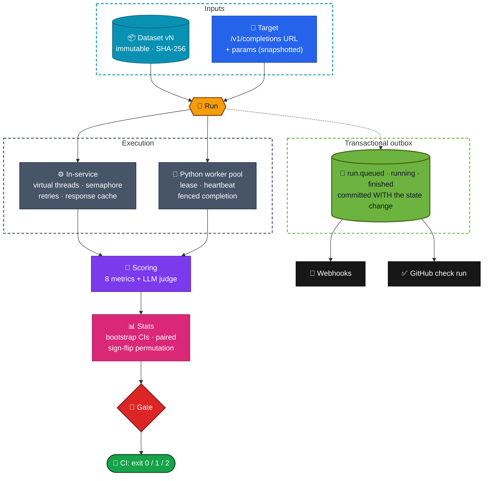
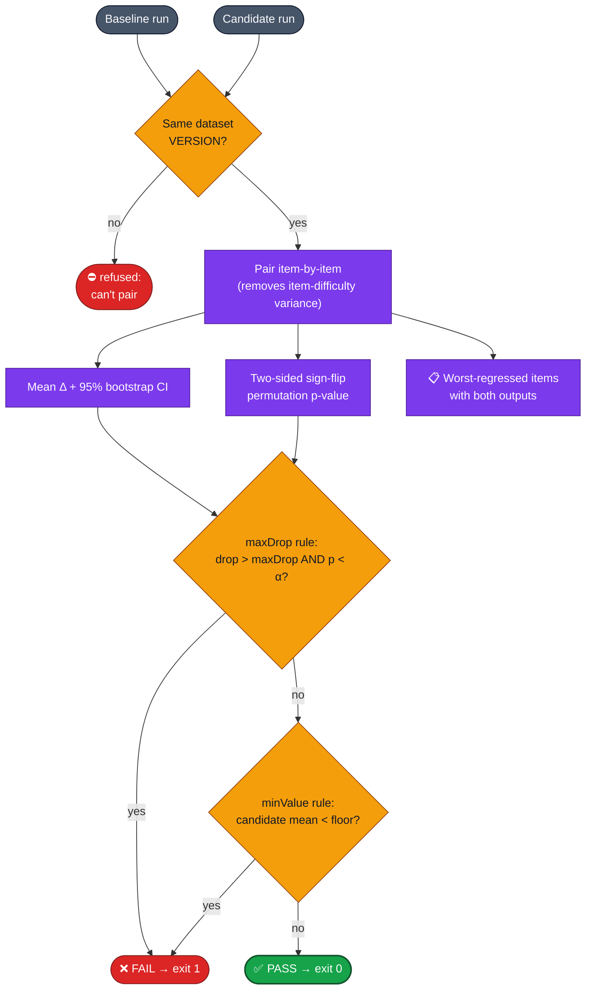
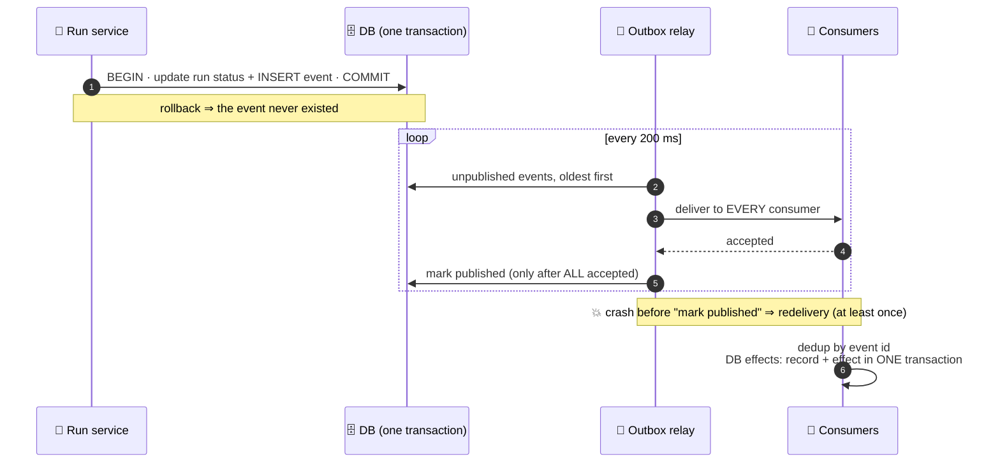
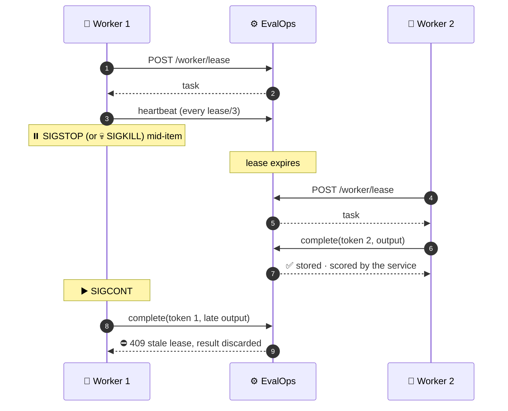
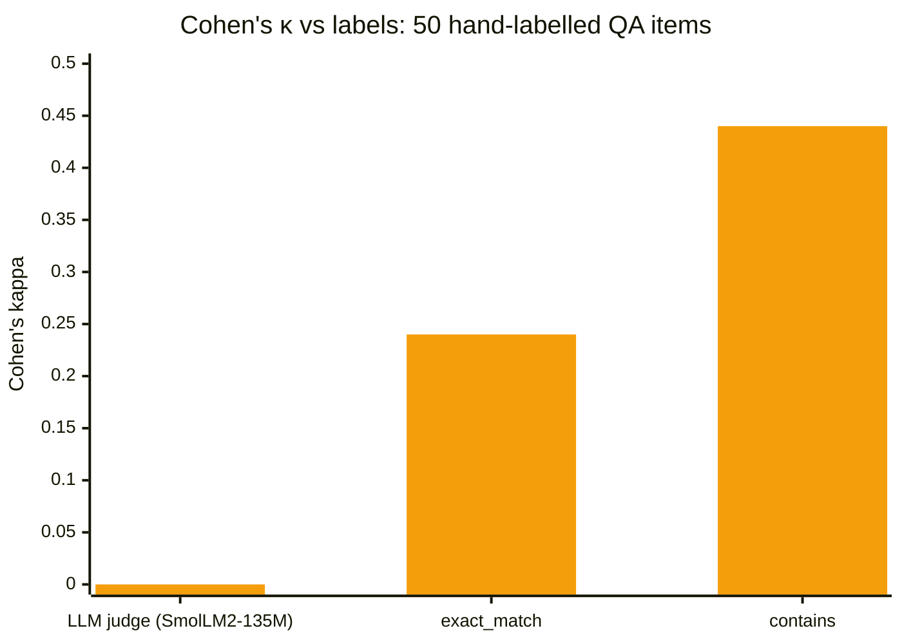
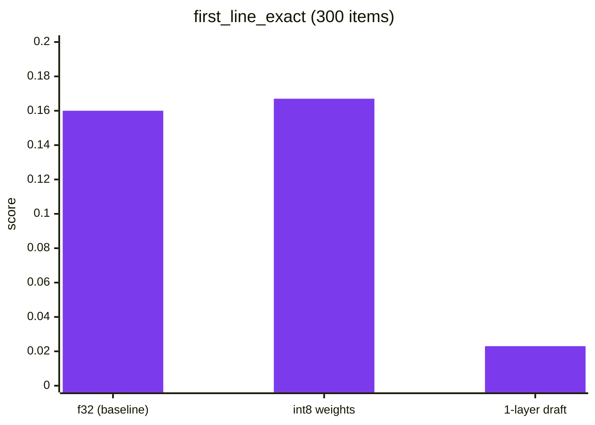

<div align="center">

# 🧪 EvalOps

### CI for LLMs: an evaluation service that runs versioned datasets against model endpoints, compares runs with paired statistics, and blocks regressions with a significance-aware gate

**Immutable datasets · paired bootstrap + sign-flip permutation tests · CI gates · transactional outbox · idempotency keys · fenced worker leases · validated LLM-as-judge · GitHub check runs**

<br/>


-16a34a?style=flat-square)


-f59e0b?style=flat-square)


[**Why**](#-why) · [**Architecture**](#%EF%B8%8F-architecture) · [**Statistics & gates**](#-statistics--ci-gates) · [**Reliability**](#-reliability) · [**LLM judge**](#%EF%B8%8F-llm-as-judge-validated-before-trusted) · [**Demo**](#-demo-evaluating-my-own-llm-engine) · [**Quick start**](#-quick-start)

</div>

---

## 💡 Why?

"The new model *feels* better" isn't evidence. A 2-point drop on 300 items can be noise, or a real regression. EvalOps answers that the way a statistician would, and wires the answer into CI:

| | |
|---|---|
| 📦 **Datasets** | Named, **immutable**, content-versioned (SHA-256 of canonical JSON); identical uploads reuse a version |
| 🎯 **Runs** | Dataset version × **snapshot** of the target config × metrics; bounded concurrency on virtual threads, retries with backoff, a **response cache**, and **resume after a crash** |
| 📏 **Metrics** | exact match · contains · regex · first-line exact · edit similarity · ROUGE-L · BLEU-4 · JSON validity · **LLM judge** |
| 📊 **Statistics** | 95% **bootstrap intervals** per metric; **paired** item-by-item comparison with a **sign-flip permutation p-value**; seeded, so reports reproduce |
| 🚦 **Gates** | `maxDrop` fails only if the drop is large **and significant**; `minValue` sets a floor; `scripts/gate.sh` gives exit codes 0 / 1 / 2 for CI |
| 🛡️ **Reliability** | Transactional outbox (at-least-once, idempotent consumers) · idempotency keys · Python workers with **leases and fencing tokens** · idempotent **GitHub check runs** |

---

## 🏗️ Architecture



---

## 📊 Statistics & CI gates



**The statistics are themselves tested, not just used:**
- 📐 **Bootstrap coverage:** over 300 simulated samples, the 95% interval contains the true mean 91–98% of the time.
- 🎯 **Calibration:** between two runs of *equal* quality, the false-positive rate at α = 0.05 is **2–9%**.
- 💪 **Power:** a +0.15 effect is detected in **> 90%** of trials at n = 300. A first version used n = 150, where analytic power is only about 0.82: *the test's expectation was wrong, not the code*, and it was corrected.
- 🐞 **Design flaw caught:** a `minValue`-only rule silently applied a drop check (`maxDrop` defaulted to 0). Each condition now applies only when given.

---

## 🛡️ Reliability

### Transactional outbox: events never lost, effects never doubled



<sub>When an event fails, later events of the <i>same run</i> wait, so ordering is preserved, while other runs continue. External receivers deduplicate on <code>X-EvalOps-Event-Id</code>.</sub>

### Idempotency keys

`POST /runs` with `Idempotency-Key`: same key + same body → the original run with `Idempotent-Replayed: true`; same key + different body → **422**. **8 concurrent first attempts create exactly one run** and one `run.queued` event: the losers hit the key constraint, roll back completely and return the winner.

### Workers with leases and fencing tokens



<sub>Tested with real Python worker processes killed with <b>SIGKILL</b> and paused with <b>SIGSTOP</b>. A lease is a conditional <code>UPDATE</code> on the current token, so of two racing workers only one wins.</sub>

### GitHub check runs

`run.queued` creates the check run (`external_id: evalops-run-<id>`), `run.running` sets it `in_progress`, and `run.finished` completes it with the gate's verdict and a Markdown summary. Before creating, the publisher **lists the commit's check runs and reuses a matching `external_id`**, so a redelivered event, or a crash between GitHub's reply and storing the id, never creates a duplicate. Supports a token, or **GitHub App auth** (RS256 JWT → installation token, cached).

---

## ⚖️ LLM-as-judge: validated before trusted

The judge uses a **fixed rubric** (`correctness-v1`), deterministic decoding (temperature 0, seed 0), cached verdicts, snapshotted judge config and parse tracking. Most importantly, there's a **validation harness** that measures its agreement with labels before anyone trusts it.



| Set | Scorer | Accuracy | **Cohen's κ** |
|---|---|:---:|:---:|
| Hand-labelled (50) | **LLM judge** | 0.50 | **0.00** |
| Hand-labelled (50) | contains | 0.72 | 0.44 |
| Arithmetic (60) | **LLM judge** | 0.57 | **0.08** |
| Arithmetic (60) | exact_match | 1.00 | 1.00 |

> [!IMPORTANT]
> **Verdict: a 135M-parameter judge is not usable.** Agreement is at chance, it often breaks the one-word format, and on arithmetic it says YES whenever it answers at all. The plumbing is correct and deterministic (identical verdicts on an uncached re-run, 50/50 and 60/60). **The point of the feature is the harness:** point it at a larger model and require κ > 0.6 before letting a judge gate anything. See [`judge.md`](docs/judge.md)

---

## 🎬 Demo: evaluating my own LLM engine

`demo/run_demo.sh` launches three replicas of my [LLM inference engine](https://github.com/siddhaantxsingh/LLM-INFERENCE-ENGINE) and evaluates them on **300 next-line completions of held-out Python code**:



| Candidate vs f32 | first-line exact Δ | edit similarity Δ | Gate |
|---|:---:|:---:|:---:|
| **int8 weights** | +0.007 (p = 0.49) | −0.002 (p = 0.66) | ✅ **PASS** (exit 0) |
| **1-layer draft model** | −0.137 (p < 0.001) | −0.085 (p < 0.001) | ❌ **FAIL** (exit 1) |

```text
FAIL first_line_exact: dropped 0.1367 (p = 0.0005) beyond the allowed 0.0200 (baseline 0.1600, candidate 0.0233)
FAIL edit_similarity:  dropped 0.0845 (p = 0.0005) beyond the allowed 0.0200 (baseline 0.4989, candidate 0.4144)
→ draft: exit 1 (fail)
```

<sub>The int8 result agrees with the engine's own perplexity measurement (+0.01%). <b>Building the demo found two bugs:</b> <code>gate.sh</code> exited 1 (fail) on a parse error, so it now exits 2 for "couldn't evaluate", and the engine's <code>llm serve</code> ignored SIGTERM, which is now handled gracefully.</sub>

---

## ✅ Testing

**16 tests** (`mvn verify`), running the real service against a fake OpenAI-compatible server whose accuracy is a parameter and which injects 503s and 400s.

| Suite | Highlights |
|---|---|
| `MetricsStatsTest` | Metrics on hand-computed cases (kitten/sitting edit similarity, ROUGE-L, BLEU) · **bootstrap coverage · false-positive rate · power** · reproducible reports |
| `EvalOpsIntegrationTest` | Content versioning · flaky items take exactly 2 attempts, while a 400 is never retried · **an identical re-run sends zero requests** · real regression vs noise separated, equal quality never false-alarms · **an interrupted run resumes with exactly the 13 remaining requests** |
| `ReliabilityIntegrationTest` | Outbox survives a publish failure and a crash after delivery (the counter moves **once**) · 8 concurrent idempotent creates → **one run** · GitHub call sequence, headers and **no duplicate check runs** · GitHub App JWT verified · judge determinism · **SIGKILL and SIGSTOP workers fenced out** |

Details: [`testing.md`](docs/testing.md)

---

## 🚀 Quick start

```sh
mvn -B package
java -jar target/evalops-0.1.0.jar                    # :8095, H2 file in ./data

curl -X POST :8095/datasets -H 'Content-Type: application/json' \
     -d '{"name":"qa","items":[{"input":"2+2=","reference":"4"}]}'
curl -X PUT  :8095/targets/my-model -H 'Content-Type: application/json' \
     -d '{"url":"http://127.0.0.1:8080/v1/completions","params":{"max_tokens":8}}'
curl -X POST :8095/runs -H 'Content-Type: application/json' -H 'Idempotency-Key: ci-123' \
     -d '{"dataset":"qa","target":"my-model","metrics":["exact_match"]}'
curl :8095/runs/1                                     # means with 95% intervals

scripts/gate.sh http://127.0.0.1:8095 1 2 '[{"metric":"exact_match","maxDrop":0.01}]'   # exit 0 / 1 / 2
```

<details>
<summary><b>🐍 Workers, judge validation, demo</b></summary>

<br/>

```sh
# run items on an external worker pool (Python stdlib only)
curl -X POST :8095/runs -H 'Content-Type: application/json' \
     -d '{"dataset":"qa","target":"my-model","metrics":["exact_match"],"executor":"worker"}'
python3 worker/worker.py --evalops http://127.0.0.1:8095 --threads 4

judge/run_validation.sh docs/evidence/judge         # judge vs labels with a real local model
demo/run_demo.sh demo/results                       # f32 vs int8 vs draft of llm-inference-engine
```

</details>

<details>
<summary><b>🔌 API</b></summary>

<br/>

| Method | Path | Purpose |
|---|---|---|
| `POST` | `/datasets` | Upload → version |
| `GET` | `/datasets`, `/datasets/{name}/{version}` | List / fetch |
| `PUT` | `/targets/{name}` | `{url, model?, params?}` |
| `POST` | `/runs` | `{dataset, version?, target, metrics, concurrency?, cache?, executor?, judge?, github?}` → 202 |
| `GET` | `/runs/{id}`, `/runs/{id}/results` | Summary with intervals / per-item rows |
| `GET` | `/compare?baseline=&candidate=` | Paired comparison + worst regressions |
| `POST` | `/gates/check` | `{baseline, candidate, rules}` → `{pass, checks}` |
| `POST` | `/worker/lease`, `/worker/heartbeat`, `/worker/complete` | Fenced worker protocol (409 = stale) |
| `GET` | `/actuator/prometheus` | Item counters by outcome |

</details>

---

## ⚠️ Limitations

- **No auth or multi-tenancy.** Deploy it behind an authenticating proxy.
- **Embedded H2, single instance.** The outbox relay is single-instance, polling and at-least-once, with no dead-letter table.
- **`/v1/completions` only:** no chat, tool calls or multi-turn conversations, and no execution-based metrics such as pass@k.
- **The only judge model available was unusable.** The hand-labelled set is small (50 items, one annotator).
- **GitHub checks were tested against a local fake API only.** Outbox crash tests are simulated in-process; worker crashes are real.
- **No multiple-comparison correction** across gate rules.

Full list: [`limitations.md`](docs/limitations.md) · Design: [`design.md`](docs/design.md) · Demo: [`demo.md`](docs/demo.md)

---

## 📁 Repository layout

```text
EVALOPS/
├── src/main/java/dev/siddhant/evalops/
│   ├── api/        🌐 REST API + worker lease protocol
│   ├── runner/     🏃 run execution, judge, reports
│   ├── metrics/    📏 8 metrics
│   ├── stats/      📊 bootstrap, paired sign-flip permutation, gates
│   ├── outbox/     📮 relay, idempotent consumers, webhooks, GitHub checks
│   └── store/      🗄️ H2 / JDBC store
├── src/test/       ✅ metrics/stats · integration · reliability
├── worker/         🐍 stdlib Python worker
├── judge/          ⚖️ labelled sets + validation harness
├── demo/           🎬 llm-inference-engine evaluation
├── scripts/        🚦 gate.sh
└── docs/           📖 design · testing · judge · demo · limitations
```

---

<div align="center">

**Don't ship on vibes. Ship on p-values.**

<br/>

Built by **[Siddhant Singh](https://github.com/siddhaantxsingh)** · <sub>MIT License</sub>

</div>
